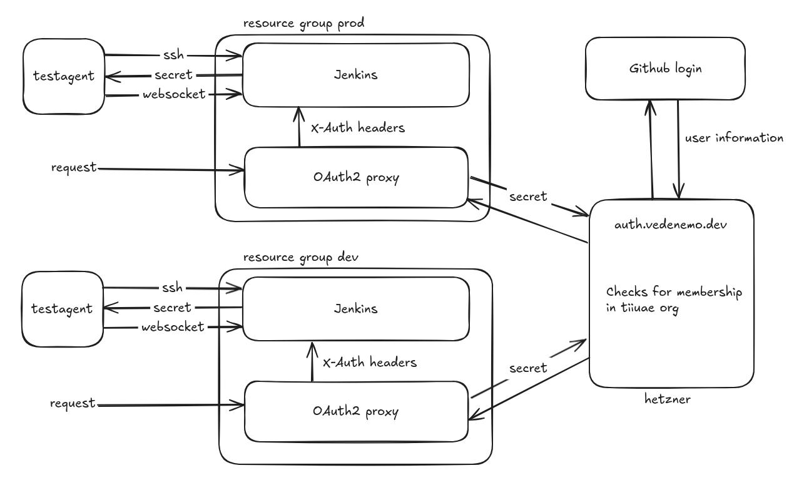

<!--
SPDX-FileCopyrightText: 2022-2026 TII (SSRC) and the Ghaf contributors
SPDX-License-Identifier: CC-BY-SA-4.0
-->

# Jenkins authentication

The Jenkins authentication setup relies on a few pieces working together:

- [Github app](https://github.com/apps/vedenemo-auth) installed in the tiiuae
  org
  - Callback url `https://auth.vedenemo.dev/callback`
  - Permissions:
    - Organization members: read-only
    - Account email addresses: read-only
- Central authentication server (auth.vedenemo.dev)
  - Config located at /hosts/ghaf-auth/
  - Runs [dex](https://dexidp.io/) with a github connector
  - Has a whitelist of callback addresses for clients
- [Oauth2 Proxy](https://oauth2-proxy.github.io/oauth2-proxy/) on the
  controller, requests to Jenkins are proxied through here with caddy.
  Configuration needs to include a client secret that matches the client
  configured in ghaf-auth. The proxy and Caddy are enabled with
  `services.ghaf-jenkins.auth` in the [Jenkins module](../modules/jenkins/).
- The Jenkins controller itself, accessible only through the proxy.



## Reusing the authentication server

Import `ghaf-infra.nixosModules.auth-server` into a NixOS configuration and enable
`services.auth-server`. The module needs no flake-specific arguments or other
ghaf-infra modules. For example, with `ghaf-infra` passed as a module argument:

```nix
{ ghaf-infra, ... }:
{
  imports = [ ghaf-infra.nixosModules.auth-server ];

  services.auth-server = {
    enable = true;
    domain = "auth.example.org";
    environmentFile = "/run/secrets/dex-env";
    # Defaults to 127.0.0.1:5556; IPv6 listeners use e.g. [::1]:5556.
    listenAddress = "127.0.0.1:5556";
    github.settings.orgs = [
      {
        name = "example-org";
        teams = [ "developers" ];
      }
    ];
    settings = {
      frontend.issuer = "Example Auth";
      staticClients = [
        {
          id = "example-app";
          name = "Example App";
          redirectURIs = [ "https://app.example.org/oauth2/callback" ];
          secretEnv = "APP_CLIENT_SECRET";
        }
      ];
    };
  };

  services.nginx.virtualHosts."auth.example.org" = {
    enableACME = true;
    forceSSL = true;
  };
  security.acme = {
    acceptTerms = true;
    defaults.email = "admin@example.org";
  };
  networking.firewall.allowedTCPPorts = [ 80 443 ];
}
```

Provision the environment file separately with `GITHUB_CLIENT_ID`,
`GITHUB_CLIENT_SECRET`, and the client credentials. GitHub login and the nginx
reverse proxy are enabled by default. `github.settings` recursively overrides the
GitHub connector configuration, including credentials, callback URL, organization
and team restrictions. Without `orgs`, GitHub login allows any GitHub user.
The module enables nginx and configures the proxy through the standard NixOS
`services.nginx` options, following the pattern used by nixpkgs service modules.
Extend `services.nginx.virtualHosts.<domain>` to configure TLS, certificates,
aliases, or additional locations. ACME account and firewall settings are configured
separately. Our production host imports the [shared nginx profile](../modules/nginx.nix)
for its site defaults.

The issuer defaults to `https://` plus `domain`; override `issuer` for a different
public URL or path prefix. `settings` accepts Dex configuration and recursively
overrides the module defaults, including branding, token lifetimes, login behavior,
and storage. Storage defaults to SQLite at `/var/lib/dex/dex.db`, managed by systemd
for the `dex` service account. The Dex package can be changed with `package`.

Set `github.enable = false` to configure other login methods with
`settings.connectors`, or `nginx.enable = false` to use an external reverse proxy.
Lists supplied through `settings`, including `connectors`, replace their defaults.
The nginx proxy follows the effective Dex HTTP listener. System hostname,
monitoring, hardware, and secret management are supplied by the consumer.
The production host's proxy and access policy are in
[`hosts/ghaf-auth/configuration.nix`](../hosts/ghaf-auth/configuration.nix).

## Authorization

Jenkins trusts the user and group headers set by OAuth2 Proxy and maps OIDC
groups to Jenkins permissions through `services.ghaf-jenkins.auth.groups`.
The shared mapping in [`hosts/hetzci/common.nix`](../hosts/hetzci/common.nix)
gives all authenticated users read access, `tiiuae:devenv-fi` members
administrator access, and `tiiuae:ci-dev-admins` members permission to build,
configure, and replay jobs.

## Generating secrets

### OAuth2 cookie secret

Used for encrypting the stored session cookies

```sh
openssl rand -base64 32 | tr -- '+/' '-_'
```

### OAuth2 client secret

Used to authenticate with the ghaf-auth server

```sh
openssl rand -base64 32
```
